<a href="https://github.com/NIKHIL-956653">
  
</a>

  
  
  




<a href="https://github.com/NIKHIL-956653/enterprise-agent-platform"></a>

  
  

<a href="https://github.com/NIKHIL-956653/GenAI-Document-Writing-Assistant"></a>

  
  

<a href="https://github.com/NIKHIL-956653/medical-bill-ocr"></a>

  

<a href="https://github.com/NIKHIL-956653/rag-curriculum"></a>

  
  



  

  
  
  

<a href="https://github.com/NIKHIL-956653">
  
</a>

<!--
How this page is built
  scripts/build_cards.py          content → assets/*.svg          (edit CONTENT at the top, re-run, commit)
  scripts/fetch_contributions.py  GitHub → data/contributions.json (runs daily in the workflow)
  scripts/build_heatmap.py        data → assets/contribution-heatmap.svg
  .github/workflows/refresh-heatmap.yml   daily refresh, commits as the profile owner
-->
