  
  
  

  
  

  
  

  

  
  

  

  
  
  

<!--
How this page is built
  scripts/build_cards.py          content → assets/*.svg          (edit CONTENT at the top, re-run, commit)
  scripts/fetch_contributions.py  GitHub → data/contributions.json (runs daily in the workflow)
  scripts/build_heatmap.py        data → assets/contribution-heatmap.svg
  .github/workflows/refresh-heatmap.yml   daily refresh, commits as the profile owner
-->
